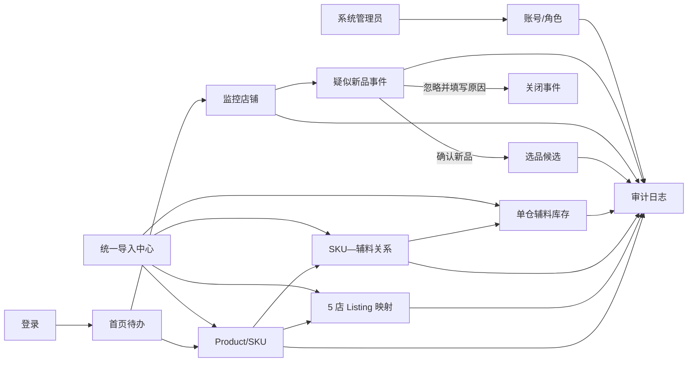
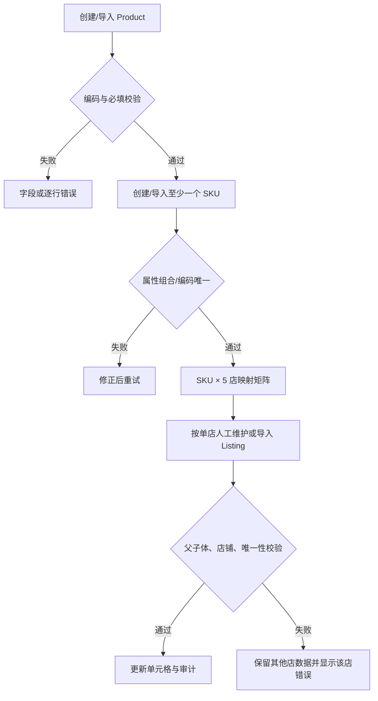
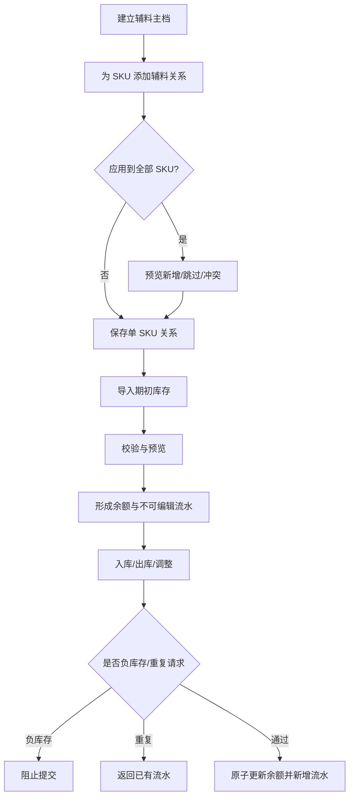
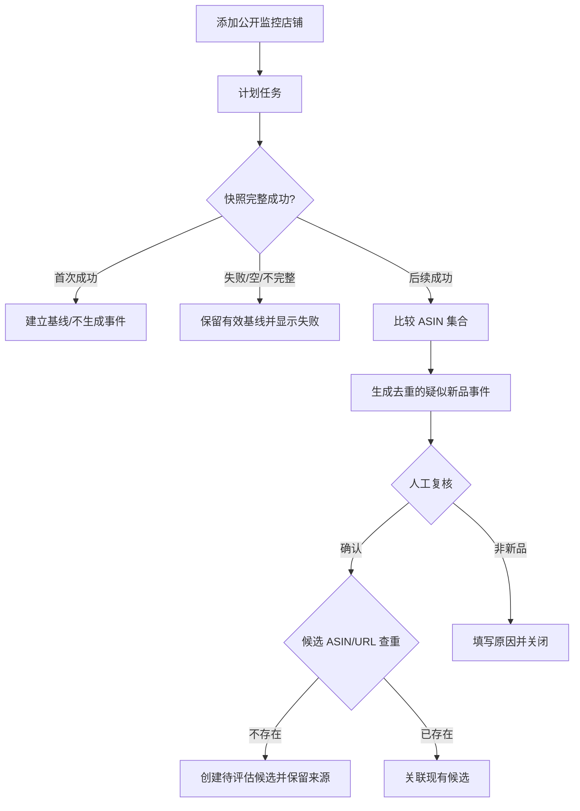

# S0-UI-01 桌面端低保真信息架构与核心流程

| 字段 | 内容 |
| --- | --- |
| 项目 | 九更亚马逊 ERP |
| 交付物 ID | DEL-016 |
| Owner | UI |
| 关联 Sprint/任务 | Sprint 0 / S0-UI-01 |
| 版本 | v0.1 |
| 状态 | Completed |
| 日期 | 2026-09-12 |
| 适用终端 | 公司桌面端最新版 Chrome / Edge；基准画布 1440 × 900 |

## 1. 目标与边界

本稿用于冻结 MVP 的页面层级、核心任务路径、信息优先级和状态反馈，供 Frontend、Backend、QA 在 Sprint 0 对齐。它是可评审的灰阶低保真规格，不是高保真视觉稿。

**覆盖：** 登录、首页、Product/SKU、5 店 Listing、辅料主档及 SKU—辅料关系、单仓辅料库存、选品候选、监控店铺、上新事件、账号/角色、审计，以及六类 Excel 导入的校验/预览/结果。

**明确不覆盖：** 移动端、公开注册、复杂审批、多租户、多仓、成品库存、采购/生产/财务/广告、5 店 SP-API 自动同步、实时监控、多站点、复杂数据权限和高保真品牌视觉。

## 2. 设计输入与关键结论

| 输入 | 采用的约束 |
| --- | --- |
| PRD v1.0 | 三角色；内部 Product/SKU 为主数据；Listing MVP 人工/Excel 维护；监控首次成功只建基线 |
| 权限矩阵 v1.0 | 菜单隐藏与接口鉴权并行；产品/辅料人员无账号管理；选品人员无库存权限 |
| 产品数据模型 v1.0 | Product、Amazon Catalog、Store Listing 三层分离；SKU 行 × 5 店列呈现映射覆盖 |
| UI/UX 规范 v0.1 | 每个关键页面必须可表达正常、空、加载、失败、无权限和数据异常 |
| 七域字段字典 v1.0 | UI/导入共用编码、枚举、条件必填、引用和唯一性规则；字段错误需定位到具体控件/行 |
| Sprint 0 计划 | 只交付低保真 IA/流程，不实现正式功能，不扩大 MVP |

### 2.1 低保真原则

1. **任务优先：** 首页先显示“要处理什么”，详情页先显示状态与关键动作。
2. **主档与渠道分离：** Product/SKU 不直接承载 5 店字段；Listing 映射独立呈现。
3. **高风险动作可撤回或可追溯：** 不提供物理删除；停用、库存调整、状态流转需原因并进入审计。
4. **先校验再写入：** 所有 Excel 导入遵循上传 → 校验 → 预览 → 提交/结果。
5. **失败不伪装为空：** 请求失败、无数据、无权限、过滤无结果使用不同页面状态。

## 3. 角色、导航与路由

### 3.1 桌面端应用壳

```text
┌──────────────────────────────────────────────────────────────────────────────┐
│ 九更 ERP   [全局搜索：产品编码 / SKU / ASIN]       帮助   通知   用户菜单  │ 64
├───────────────┬──────────────────────────────────────────────────────────────┤
│ 首页          │ 面包屑                                    页面主操作       │
│ 产品管理      │ 页面标题 · 辅助说明 / 状态                                  │
│  ├ 产品/SKU   ├──────────────────────────────────────────────────────────────┤
│  ├ Listing映射│ 筛选区 / 摘要                                                │
│  ├ 辅料主档   │                                                              │
│  ├ 辅料库存   │ 主内容：表格、详情、状态反馈                                 │
│  └ 导入中心   │                                                              │
│ 选品管理      │                                                              │
│  ├ 候选池     │                                                              │
│  ├ 监控店铺   │                                                              │
│  └ 上新事件   │                                                              │
│ 系统管理      │                                                              │
│  ├ 用户与角色 │                                                              │
│  └ 审计日志   │                                                              │
└───────────────┴──────────────────────────────────────────────────────────────┘
   240 px                            内容区 min 960 px / max 1600 px
```

- 侧栏一级组默认展开当前组；折叠后保留图标与 Tooltip。
- 顶栏全局搜索仅查 Product 编码、内部 SKU、ASIN，结果按实体分组；不承担复杂筛选。
- 页面结构固定为：面包屑 → 标题/说明/主操作 → 筛选或摘要 → 内容 → 分页。
- 新增/编辑复杂实体使用独立页；轻量单记录维护使用右侧 480–640 px 抽屉；确认与原因输入使用 480 px 对话框。

### 3.2 路由树

```text
/login
/
├── /home
├── /products
│   ├── /new
│   └── /:productId
│       ├── overview
│       ├── variants
│       ├── materials
│       ├── listings
│       └── changes
├── /listing-mappings
├── /materials
├── /inventory
│   ├── balances
│   └── ledger
├── /imports
│   └── /:batchId
├── /selection/candidates
│   └── /:candidateId
├── /watch/stores
├── /watch/events
├── /system/users
└── /system/audit
```

### 3.3 角色可见性与动作权限

| 页面/动作 | 系统管理员 | 产品/辅料人员 | 选品人员 |
| --- | --- | --- | --- |
| 首页 | 全局摘要 | 本岗位摘要 | 本岗位摘要 |
| Product/SKU、5 店 Listing | 管理 | 操作 | 查看 |
| 辅料主档、SKU—辅料关系 | 管理 | 操作 | 查看 |
| 辅料库存/流水 | 管理 | 操作 | 菜单不可见；直达显示 403 |
| 选品候选、监控店铺/事件 | 管理 | 查看 | 操作 |
| 导入中心 | 全部六类 | 产品/SKU、Listing、辅料、关系、期初库存 | 无入口 |
| 用户与角色 | 管理 | 菜单不可见；直达显示 403 | 菜单不可见；直达显示 403 |
| 审计日志 | 查看全局 | 仅本人操作 | 仅本人操作 |

> “查看”角色保留筛选、查看详情和导出已授权数据；新增、编辑、导入、停用、状态流转按钮不渲染。前端隐藏仅改善体验，后端仍需逐接口鉴权。

## 4. 全局组件与反馈规范

### 4.1 低保真实现映射（Tailwind）

| 对象 | 建议类名 | 低保真用途 |
| --- | --- | --- |
| 页面背景 | `bg-slate-50 text-slate-900` | 保持灰阶，不定义品牌色 |
| 内容卡 | `rounded-lg border border-slate-200 bg-white` | 摘要和分组容器 |
| 主按钮 | `h-9 rounded-md bg-slate-900 px-4 text-sm text-white` | 每页最多一个主操作 |
| 次按钮 | `h-9 rounded-md border border-slate-300 bg-white px-4 text-sm` | 导出、取消、次要动作 |
| 输入/选择 | `h-9 rounded-md border border-slate-300 px-3 text-sm` | 标签在控件上方，不仅靠 placeholder |
| 表格行 | `min-h-12 border-b border-slate-100` | 固定表头，行点击不替代显式操作 |
| 状态标签 | `rounded-full bg-slate-100 px-2 py-0.5 text-xs` | 文本 + 图标/形状，不只依赖颜色 |
| 抽屉 | `w-[560px] border-l bg-white shadow-xl` | Listing、事件、流水详情 |
| 焦点 | `focus-visible:ring-2 focus-visible:ring-slate-900` | 键盘可见焦点 |

间距采用 4 px 基数：页面 24、卡片 16/24、表单行距 16、字段组距 24。点击目标不小于 36 × 36 px。正文最小 14 px；表格关键文本 14 px；辅助信息 12 px。

### 4.2 六类页面状态

| 状态 | 页面行为 | 可执行动作 |
| --- | --- | --- |
| 首次加载 | 标题与页面框架保留；摘要/表格显示等宽骨架；禁用提交 | 可返回/切换已缓存导航，不显示“暂无数据” |
| 刷新加载 | 保留旧数据并在表格顶部显示进度条；防重复提交 | 可取消筛选，不清空上下文 |
| 业务空态 | 图标占位 + “尚无 X” + 一句影响说明 | 有写权时显示创建/导入；只读时仅说明 |
| 筛选无结果 | 显示当前条件摘要 | “清除筛选”，不显示创建引导 |
| 请求失败 | 错误摘要、请求追踪 ID、发生时间 | “重试”；有草稿时保留输入 |
| 权限受限 | 403 标题、所需权限、当前角色 | “返回首页”；不提示联系人的隐私信息 |
| 数据异常 | 行/字段级标记并解释规则；列表仍可浏览其余有效数据 | “查看问题”或“修正”，不静默跳过 |

### 4.3 写操作反馈

- 提交按钮点击后进入 loading，并用幂等键防止重复写入。
- 成功：页面内状态更新 + 简短 Toast；创建成功进入详情。
- 可修复校验错误：字段下方就地提示，并将焦点移动到第一个错误。
- 服务端失败：保留输入；对话框内显示失败摘要和追踪 ID。
- 停用/库存调整/候选淘汰/账号重置必须二次确认；需要原因的动作不允许空原因提交。

## 5. 核心流程总览



## 6. 页面低保真与交互

### 6.1 登录 `/login`

```text
┌────────────────────────────────────────────────────────────────────┐
│ 九更 ERP                                                          │
│                                                                    │
│                 ┌──────────────────────────────┐                   │
│                 │ 登录                         │                   │
│                 │ 账号 [____________________]  │                   │
│                 │ 密码 [____________________]👁 │                   │
│                 │ [ ] 保持登录（受策略限制）   │                   │
│                 │ [          登录           ]  │                   │
│                 │ 首次登录后必须修改密码       │                   │
│                 └──────────────────────────────┘                   │
└────────────────────────────────────────────────────────────────────┘
```

**流程：** 输入 → 本地必填校验 → 登录中 → 按角色进入首页。首次登录或管理员重置后进入“当前密码 / 新密码 / 确认密码”强制改密页，完成前不能访问业务路由。

**异常：** 账号/密码错误使用同一模糊文案；剩余尝试次数仅按安全策略允许时展示；锁定显示锁定状态和恢复方式；停用账号拒绝登录；网络失败允许重试；会话过期保存当前 URL，重新登录后回跳到有权限的原页面。退出成功回登录页。所有成功/失败/锁定/退出进入审计。

### 6.2 首页 `/home`

```text
[首页]                                      数据更新于 09:30  [刷新]
┌ 待处理 ────────┐ ┌ 数据异常 ───────┐ ┌ 今日监控 ───────┐
│ 导入失败 3     │ │ 低库存 8        │ │ 成功 1 / 失败 0 │
│ 待复核新品 12  │ │ 映射缺失 17     │ │ 新品事件 5      │
└────────────────┘ └─────────────────┘ └─────────────────┘
[我的待办：类型｜对象｜原因｜产生时间｜主操作]
[最近操作：对象｜动作｜结果｜时间]
```

- 卡片按权限裁剪：选品人员不看低库存；产品/辅料人员只读监控摘要；管理员看全局。
- 数字为可点击筛选入口，不设计经营分析图表。
- 全部为零时显示“当前没有待处理事项”，不隐藏模块。
- 任一卡片独立失败，不阻塞其他卡片；失败卡片显示重试。

### 6.3 Product/SKU `/products` 与 `/:productId`

**列表线框**

```text
[产品 / SKU]                   [下载模板] [导入] [+ 新建产品]
[关键词________] [品牌⌄] [类目⌄] [状态⌄] [查询] [重置]
产品编码 ↕ | 中文/英文名称 | 品牌 | 类目 | SKU 数 | Listing 覆盖 | 状态 | 更新 | …
P-10001     | 收纳盒          | —   | 家居 | 4      | 18 / 20      | 启用 | 今天 | 查看
```

- 关键词匹配产品编码、名称、内部 SKU；默认按最近更新倒序。
- `Listing 覆盖` 显示已映射单元格/全部 SKU × 5 店，不表示在售率。
- 停用产品仍可查，默认筛选“启用 + 草稿”；停用动作要求原因且不物理删除。
- 空态有写权时显示“新建产品 / 导入产品”；只读角色只显示说明。

**详情五页签**

1. **基础信息：** 产品编码、中文/英文名、品牌、内部类目、Amazon Product Type 候选、描述、状态；编码由人工输入且全局唯一。
2. **SKU/规格：** SKU 编码、规格名、条码、材质、尺寸/重量、动态属性、状态；同 Product 内完整属性组合重复时阻止保存。
3. **对应辅料：** 见 6.5。
4. **Amazon 映射：** 见 6.4。
5. **变更记录：** 字段、前值、后值、操作人、时间、来源批次。

**新建流程：** `基础信息 → 至少新增 1 个 SKU → 保存草稿/启用 → 进入详情`。关闭未保存页面时提示；SKU 表单允许添加动态属性行，属性编码同一 SKU 内不得重复。选品人员打开详情仅查看，不渲染写操作。

### 6.4 5 店 Listing 映射 `/listing-mappings`

```text
[5 店 Listing 映射]              [下载模板] [导入映射] [+ 新建映射]
[产品/SKU________] [缺失映射⌄] [Listing状态⌄] [查询]
内部 SKU    | 店铺 A       | 店铺 B       | 店铺 C       | 店铺 D       | 店铺 E
SKU-001     | ● 有效       | ◐ 草稿       | + 未映射      | ! 受限       | ● 有效
             单元格副文案：Seller SKU / ASIN；点击打开详情抽屉
```

**详情抽屉字段：** 店铺、Seller SKU、ASIN、Listing 角色（独立/父/子）、父 Listing、FNSKU、履约（FBA/FBM）、Listing 状态、问题摘要、关联 Product、关联内部 SKU、来源/导入批次、更新时间。

**约束反馈：**

- 父体只能关联 Product，选择 `PARENT` 后 SKU 字段清空并禁用；子体/独立必须选 SKU。
- 父子 Listing 必须同店铺；同店铺 Seller SKU 唯一；同一内部 SKU 在同店铺默认仅一个有效 Listing。
- 五个店铺信息严格按列/店铺隔离；单店保存失败不回滚或覆盖其他店内容。
- MVP 不出现“同步 Amazon”按钮；只提供人工新增/编辑和 Excel 导入。
- 未映射单元格是业务空态；加载失败的单元格显示“加载失败/重试”，不可表现为未映射。

### 6.5 辅料主档与 SKU—辅料关系

**辅料主档 `/materials`：** 关键词、类型、状态筛选；列为辅料编码、名称、类型、规格、单位、安全库存、状态、更新时间；支持新建、编辑、停用、导入/导出。编码人工输入且全局唯一。

**产品详情 > 对应辅料：**

```text
[SKU 选择：SKU-001⌄]                  [应用到全部 SKU] [+ 添加辅料]
辅料编码 | 名称 | 标准用量 | 单位 | 损耗率 | 启用 | 备注 | …
M-001    | 彩盒 | 1.00     | 个   | 2%     | 是   | —    | 编辑
```

**流程：** 选择 SKU → 添加已有辅料 → 填标准用量/单位/损耗率 → 保存。`应用到全部 SKU` 打开预览，列出将新增、跳过已存在和冲突的 SKU；确认后为每个 SKU 生成独立关系，不呈现继承关系。之后每个 SKU 可单独编辑。

**异常：** Product 无 SKU 时提示先创建 SKU；辅料停用时不可新增关系但历史关系保留；引用不存在、重复关系、用量 ≤ 0、损耗率越界均字段级提示；批量部分失败时返回逐 SKU 结果。

### 6.6 单仓辅料库存 `/inventory`

**余额页签**

```text
[辅料库存 · 固定单仓]       [导入期初库存] [+ 入库] [+ 出库] [+ 盘点调整]
[辅料________] [仅低库存□] [状态⌄] [查询]
辅料编码 | 名称 | 现存 | 安全库存 | 库存状态 | 最近变动 | …
M-001    | 彩盒 | 120  | 100      | 正常     | 今天     | 查看流水
```

**流水页签：** 流水号、辅料、类型（期初/入库/出库/调整）、数量（带正负号）、变动前、变动后、业务日期、原因/备注、幂等请求号、操作人、创建时间。流水只读，无编辑/删除。

**记账流程：** 选择动作 → 选择辅料 → 数量/业务日期/原因 → 右侧即时预览“变动前 → 变动后” → 确认 → 成功页返回流水号。出库导致负库存时阻止确认；纠错必须新建反向调整并引用原流水。

**状态：** 无期初数据引导导入；低库存使用文字 + 图标；余额/流水不一致显示高优先异常并禁止继续该辅料的变动，提供追踪 ID；重复提交返回已有流水而非重复记账；选品人员直达为 403。

### 6.7 选品候选 `/selection/candidates`

```text
[选品候选池]                                  [+ 手工录入候选]
[ASIN/标题____] [状态⌄] [来源店铺⌄] [负责人⌄] [标签⌄] [查询]
图片 | ASIN/标题 | 价格/评分/评论 | 来源 | 状态 | 负责人 | 发现时间 | …
```

**手工流程：** 输入 ASIN 或标准化 URL → 查重 → 填标题/图片/类目/价格/评分/评论、来源、标签、负责人、选品理由 → 保存为待评估。

**状态流：** `待评估 → 评估中 → 通过` 或 `待评估/评估中 → 淘汰`。淘汰必须填写原因；状态、负责人、理由变化进入审计。ASIN 重复时不创建，跳转已有候选并说明来源；无 ASIN 时以标准化 URL 暂存。产品/辅料人员仅查看。

### 6.8 监控店铺 `/watch/stores`

```text
[监控店铺]                                      [+ 添加公开店铺]
店铺名称 | 公开链接 | 状态 | 最近有效快照 | 最近任务 | 基线商品数 | …
对标店 A | amazon… | 观察中 | 09-12 08:00  | 成功     | 128        | 详情
```

**添加流程：** 名称 + 合法公开 Amazon 美国站店铺链接 → URL 校验 → 保存 → 等待首个任务。首次完整成功快照状态为“基线已建立”，不生成新品事件。

**任务状态：** 待运行、运行中、成功、失败、结果为空、分页不完整、人工暂停。失败/空结果/分页不完整均明确显示“未更新有效基线”；只在完整成功时替换有效基线。页面提供最近任务、有效基线、覆盖率/完整性、失败原因和人工导入降级入口；不提供绕过验证码或访问控制的操作。

### 6.9 上新事件 `/watch/events`

```text
[上新事件] [待复核 12] [今日新增 5]
[ASIN____] [监控店铺⌄] [复核状态⌄] [发现日期⌄] [查询]
图片 | ASIN/标题 | 来源店铺 | 首次发现 | 证据快照 | 状态 | …
```

**复核抽屉：** 新旧快照摘要、ASIN、标题/图片、公开 URL、首次发现时间、数据完整性、关联候选（如有）。主操作：`确认并加入候选`；次操作：`标记非新品`（必填原因）。

**约束：** 同一监控店铺 + ASIN 只产生一次首发事件；确认时再次查重候选，已有候选则建立来源关系并跳转，不重复创建；证据加载失败不影响事件存在，但明确标记不可预览。产品/辅料人员仅查看。

### 6.10 用户与角色 `/system/users`

```text
[用户与角色]                                      [+ 创建账号]
[账号/姓名____] [角色⌄] [状态⌄] [查询]
账号 | 姓名 | 角色 | 状态 | 最近登录 | 锁定原因 | …
```

**创建：** 账号、姓名、角色 → 生成一次性重置流程/临时状态（页面不回显密码明文）→ 首次登录强制改密。**管理动作：** 改角色、停用/启用、解锁、触发密码重置。停用后新登录被拒且已有会话失效。危险动作二次确认并记录原因。

角色权限在 MVP 为固定三角色摘要，不提供自定义权限编辑器。非管理员菜单隐藏；直达 403。

### 6.11 审计日志 `/system/audit`

```text
[审计日志]
[对象类型⌄] [动作⌄] [结果⌄] [操作人____] [时间范围____] [查询] [导出]
时间 | 操作人 | 动作 | 对象/ID | 结果 | 变更摘要 | 来源/IP摘要 | 追踪ID | 查看
```

- 管理员查看全局；其他角色查询条件中的操作人固定为本人且不可改。
- 详情抽屉显示前值/后值 diff、失败原因、来源批次/请求追踪 ID；敏感字段值始终遮蔽。
- 日志不可编辑/删除。导出继承当前权限和筛选，生成行为自身也进入审计。
- 登录、退出、失败、锁定/解锁/重置，关键新增/修改/停用、库存变动、候选状态和导入均应出现。

## 7. 六类 Excel 导入统一流程

### 7.1 入口与类型

统一入口 `/imports`，也可从对应业务列表以预选类型进入。六类：

1. 产品 Product
2. 内部 SKU / Variant
3. 店铺 Listing 映射
4. 辅料主档
5. SKU—辅料关系
6. 辅料期初库存

依赖顺序：`Product → SKU → 辅料主档 → SKU—辅料关系 → Listing 映射`；期初库存依赖辅料主档。界面不允许系统为产品/SKU/辅料编码补号。

### 7.2 四步导入器

```text
步骤 1 上传 ───── 步骤 2 校验 ───── 步骤 3 预览 ───── 步骤 4 结果

[导入类型：产品⌄] [下载当前模板]
┌ 拖拽 .xlsx 或选择文件 ┐  文件名 / 大小 / 模板版本
└───────────────────────┘
```

**步骤 1 上传**
- 显示支持格式、大小/行数限制、模板版本和导入依赖。
- 文件类型/大小错误就地拒绝；上传中显示进度并可取消；失败可重试，已选类型不丢失。

**步骤 2 校验**
- 显示 `总行数 / 可导入 / 警告 / 错误`；校验中展示阶段和已处理行数。
- 错误表：工作表、行号、字段、原值、原因、修复建议；支持只看错误和下载错误报告。
- 文件级错误（模板不匹配/缺工作表）与行级错误分开。
- 有任一阻断错误时禁用“进入预览”；修复后重新上传，不允许静默跳过错误行。

**步骤 3 预览**
- 按 `新增 / 更新 / 不变` 分组，展示关键字段前后差异和预计影响。
- Listing 按 5 店分别汇总；“应用到全部 SKU”类关系需展开实际生成记录。
- 提交前确认：导入类型、批次、行数、覆盖规则（幂等 Upsert，不物理删除）。高风险期初库存明确“仅用于初始建账”。

**步骤 4 结果**
- 状态：排队中、处理中、成功、部分失败、失败、已取消。
- 处理中显示批次 ID、开始时间、进度；离开页面后可在导入中心继续查看。
- 完成显示成功/失败/跳过计数、耗时、操作人、结果文件；失败逐行可下载。
- 部分失败不以“成功”绿色总状态掩盖；明确哪些记录已写入。重新导入使用新批次，幂等数据不重复创建。

### 7.3 导入状态线框

```text
┌ 批次 IMP-20260912-001   部分失败 ────────────────────────────────┐
│ 产品导入 · products_v3.xlsx · 操作人 A · 14:02                  │
│ 总计 1000    成功 982    失败 18    跳过 0    用时 02:41        │
│ [下载结果] [下载失败明细] [返回产品列表] [重新导入]              │
├──────────────────────────────────────────────────────────────────┤
│ Sheet | 行 | 字段         | 原值      | 原因                    │
│ product| 28 | product_code | P-001     | 编码已存在且字段冲突    │
└──────────────────────────────────────────────────────────────────┘
```

## 8. 关键端到端流程

### 8.1 产品建档至 5 店映射



### 8.2 辅料关系至库存记账



### 8.3 监控事件进入候选池



## 9. 页面状态覆盖表

| 页面 | 空态 | 加载 | 失败 | 权限受限 | 数据/业务异常 |
| --- | --- | --- | --- | --- | --- |
| 登录 | 不适用 | 登录按钮 loading | 凭据/网络失败 | 停用/锁定 | 首次改密、会话过期 |
| 首页 | 无待办 | 卡片骨架/局部刷新 | 单卡重试 | 卡片按角色裁剪 | 更新时间过旧 |
| Product/SKU | 无产品/筛选无结果 | 表格骨架 | 请求重试 | 只读隐藏写按钮 | 编码/属性组合重复 |
| 5 店 Listing | 未映射单元格 | 单元格/表格骨架 | 单店错误不伪装为空 | 只读 | 父子体/店铺/唯一性冲突 |
| 辅料关系 | SKU 尚无关系 | 行骨架 | 批量逐 SKU 失败 | 只读 | 停用辅料/用量错误 |
| 单仓库存 | 尚无期初 | 余额骨架/记账中 | 记账失败保留输入 | 选品角色 403 | 负库存/账实计算不一致 |
| 候选池 | 尚无候选 | 列表骨架 | 请求失败 | 产品角色只读 | ASIN/URL 重复、淘汰缺原因 |
| 监控店铺 | 尚未配置 | 任务运行中 | 任务失败 | 产品角色只读 | 空/分页不完整不覆盖基线 |
| 上新事件 | 暂无待复核 | 列表/证据加载 | 证据或操作失败 | 产品角色只读 | 重复事件/候选已存在 |
| 用户账号 | 尚无匹配用户 | 表格骨架 | 重置/停用失败 | 非管理员 403 | 锁定/停用/会话失效 |
| 审计日志 | 当前条件无记录 | 表格骨架 | 请求/导出失败 | 非管理员仅本人 | 敏感值遮蔽、差异不可用 |
| 导入中心 | 尚无批次 | 上传/校验/处理进度 | 文件/行/任务失败 | 无导入权 403 | 部分失败、模板版本不匹配 |

## 10. 可访问性与桌面适配

- 支持 1280 px 及以上桌面宽度；1440 px 为验收基准。窄于 1280 px 时 5 店矩阵横向滚动，内部 SKU 列冻结。
- 所有表单标签、错误提示和必填标识可由辅助技术关联；错误不只依赖颜色。
- 模态/抽屉打开后焦点进入标题，关闭后回到触发器；Esc 关闭非破坏性浮层。
- 表格支持键盘聚焦行内操作；排序状态通过文本/ARIA 表达。
- 动效仅用于 150–200 ms 的浮层/状态过渡；遵从 `prefers-reduced-motion`。

## 11. 关键决策与假设

1. 公司 5 店在系统配置中已有固定顺序；若尚未提供名称，原型使用店铺 A–E，占位不影响信息架构。
2. 已按 S0-PM-01 七域字段字典 v1.0 完成结构契约复核；真实样本到位后如需调整字段长度、类目/单位词表，只能走受控变更，不改变本 IA。
3. 首页仅做待办/异常摘要，不新增 BI、销售或利润指标。
4. 账号重置不在 UI 回显或复制明文凭据；具体安全交付机制由 IAM/API 设计确定。
5. `部分失败` 的事务粒度需 Backend 与 PM 在导入契约中明确；UI 已要求逐行结果且禁止静默丢数。

## 12. 验证过程与结果

- 对 PRD 的 8 组功能需求、权限矩阵 3 角色、产品数据模型 5 页签、七域字段字典 v1.0 和 Sprint 0 异常状态要求完成逐项映射。
- 使用[验收证据清单](S0-UI-01_ACCEPTANCE_EVIDENCE.md)核对：核心模块、六类通用状态、六类导入、三角色权限与 MVP 边界均有明确落点。
- 当前结果：设计及字段契约自检通过；PJM 已完成核验，状态 `Completed`。

## 13. 已知限制与后续评审点

- 真实脱敏样本、5 个公司店铺显示名和首期用户清单尚未提供，不阻塞 IA，但阻塞最终字段长度、空值比例和可用性验收。
- 监控 Spike 的自动化/人工降级路线尚未结论；页面同时保留失败保护和人工导入入口，不承诺自动采集能力。
- 本交付不包含高保真色彩、字体品牌化、插画、图标资产或可点击生产原型；这些必须在低保真与字段契约通过后另立任务。

## 14. 评审记录

| 评审人 | 结论 | 日期 | 意见 |
| --- | --- | --- | --- |
| UI 自检 | 通过 | 2026-09-12 | 覆盖范围、状态、权限、字段契约和导入路径完整 |
| PJM | 通过 | 2026-09-12 | 范围、三角色、全局状态、六类导入及 MVP 边界与 Approved 基线一致；相对链接与 `git diff --check` 通过。 |
