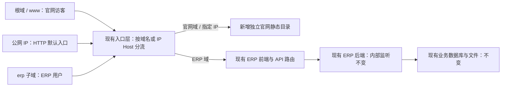

# 九更公司官网与 ERP 域名分流需求文档

| 字段 | 内容 |
| --- | --- |
| 项目 | 九更公司官网 / 域名分流，优先保持 ERP 不变 |
| 交付物 | DEL-054 |
| 版本 / 状态 | v0.6 / Draft，按用户要求将 TCP8081 对所有外网放行，未授权开发或发布 |
| 日期 | 2026-11-25，Asia/Shanghai |
| 编写 / 评审 | Codex / 用户、PJM 待评审 |
| 本轮范围 | 需求文档、参考站分析、现有代码配置核对；不修改 DNS、端口、网站代码或生产服务 |
| 工作区 | 沿用当前 Codex 本地写入槽，仅追加文档；不提交，保留 ERP-104 未提交修改；网站实施任务号由 PJM 后续分配 |

## 1. 用户已确认的目标

1. 公司官网名称为 **九更**。
2. 官网现阶段用于**域名备案的静态企业展示**，品牌定位仍为跨境电商企业；Logo、视觉及一般文案由 Codex 自主设计，参考 [亚声威格官网](https://www.yswg.com.cn/)的企业介绍和业务展示方式。
3. `jiugengerp.cn`、`www.jiugengerp.cn` 访问**九更公司官网**；`erp.jiugengerp.cn` 访问**九更 ERP**。
4. 用户最新要求：**不限定端口，优先保持当前 ERP 系统不变，仅在需要时调整域名解析与入口转发。** 取消先前公网 8080、地址带端口及官网固定 80 的约束，也取消生产后端迁移端口的建议。
5. 用户已明确公网 IP 的默认 HTTP 地址用于官网。备案期间 ERP 采用独立临时入口，建议由 Caddy 在外部 8081 提供完整 ERP；先验证该入口，再让官网接管默认入口。用户已确认安全组与防火墙对所有外网放行 TCP8081，不设员工来源IP白名单；该入口尚未部署。
6. 当前仅做需求文档。开发、域名切换与线上部署分别等待后续指令，不能沿用 ERP-103 的发布授权。

本次 v0.6 按用户要求取消临时8081的员工来源限制，保留IP官网与独立ERP临时入口方案；旧版端口迁移方案已取消，为保留文档链接，文件名不变。

设计和一般文案已获自主创作授权，无需逐项索取 Logo 或宣传语；公司主体、联系信息、资质等事实不得虚构。方案不承诺页面即可通过备案，也不假定审核人员一定通过 IP 访问。

## 2. 面向对象与网站目标

| 访问者 | 主要诉求 | 网站应提供的结果 |
| --- | --- | --- |
| 备案相关审核人员 | 了解网站用途与主体信息 | 看到真实一致的静态企业介绍，不进入内部 ERP |
| 供应商、工厂、合作伙伴 | 了解九更业务及合作方向 | 找到业务介绍和明确的合作联系方式 |
| 潜在客户、平台或业务合作方 | 判断企业是否真实、专业 | 看清企业简介、经营方向、能力及公开联系信息 |
| 普通访客、潜在员工 | 了解企业与团队 | 阅读关于九更、企业文化；招聘不是首期独立业务 |
| 内部员工 | 使用 ERP | 访问独立 ERP 地址；不经过官网账号或公开业务接口 |

首期以简洁、完整的静态企业介绍满足当前展示需要，不扩展复杂营销功能。官网不承担下单、客户报价、ERP 数据展示或员工办公功能。

## 3. 参考站观察与九更的取舍

2026-11-25 实际查看了参考站首页、业务介绍和联系页；首页为顶部导航、城市大图轮播、图文公司介绍、文化内容及多列页脚。业务页按业务能力分段，联系页以供应商合作邮箱和联系信息为主要入口。[首页](https://www.yswg.com.cn/)、[业务介绍](https://www.yswg.com.cn/business)、[联系我们](https://www.yswg.com.cn/contact)。

| 可借鉴的部分 | 九更首期建议 |
| --- | --- |
| 企业介绍、文化、业务、联系的导航结构 | 用“关于九更 / 业务介绍 / 九更文化 / 联系我们”组织内容 |
| 大图建立企业印象，图文区块讲清业务 | 首屏使用一张明确主题图、中文标题和两个行动按钮，避免默认视频或多屏轮播 |
| 业务能力分组展示 | 按九更实际确认的业务组织内容，先预留跨境运营、产品开发、供应链协作三类内容结构 |
| 合作联系方式直接可见 | 首期展示可用邮箱/电话等真实联系渠道，不做无法送达的留言表单 |
| 公司信息集中于页脚 | 页脚显示公司主体、导航和获确认的公开信息；不堆叠宣传词 |

不照搬参考公司的成立年份、规模、覆盖地区、经营品类、业绩、团队、价值观及联系方式。参考站文字、Logo、图片不作为九更素材使用。参考站的“廉洁”栏目不自动纳入：需先有实际接收渠道和处理负责人。

## 4. 首期信息架构与范围

首期采用**一个完整静态首页**，导航通过锚点进入关于、业务、理念和联系区块；不要求先建设五个独立页面。以下“页”描述作为对应区块的内容要求，未来需要时再拆页。HTML/CSS、少量交互脚本与本地素材即可，不依赖 ERP 或额外后端。

| 优先级 / 编号 | 页面或区块 | 核心内容 |
| --- | --- | --- |
| P0 / WEB-01 | 首页 `/` | 九更原创标识、品牌主张、企业简介与业务概览 |
| P0 / WEB-02 | 关于 `/#about` | 跨境电商企业介绍，不编造成立年份、规模或荣誉 |
| P0 / WEB-03 | 业务 `/#business` | 跨境运营、产品与供应链协作方向，以方向表述避免虚构既有能力 |
| P0 / WEB-04 | 理念 `/#values` | 原创品牌理念，简洁图文，无需独立文化页 |
| P0 / WEB-05 | 联系 `/#contact`、页脚 | 真实主体与可用联系资料；未提供的信息不虚构 |
| P0 / WEB-06 | 导航及404 | 锚点导航、移动菜单、返回顶部、无效路径处理 |
| P0 / INF-01 | ERP 子域 | 路由到现有完整 ERP，内部服务保持不变 |
| P0 / INF-02 | 官网域名与公网 IP 的 HTTP 入口 | 同一官网静态产物；公网 IP 不再路由至 ERP |
| 后续可选 | 独立介绍页、招聘、动态、目录、多语言 | 不纳入本期 |

首期不包含：官网 CMS 后台、新闻发布系统、在线客服接入、留言数据库、招聘投递/简历上传、公开 ERP 商品/价格/库存、商城支付及会员中心。若后续启用联系表单，应另定字段、接收人、送达/失败状态、限流、防重复及信息保存规则，不以“点击后提示成功”代替实际收件。

## 5. 页面与交互需求

### 5.1 公共导航与页脚

- 顶部：九更 Logo/文字标识、首页、关于九更、业务介绍、九更文化、联系我们。
- 点击标识返回首页；当前栏目有清晰选中态；窄屏折叠菜单可关闭、可键盘操作，跳转后收起。
- 页脚：品牌、简短介绍、页面导航、联系信息、版权主体；备案等字段按实际核实结果填写，不生成虚构编号。
- 本期官网不放员工入口，ERP 直接通过 `https://erp.jiugengerp.cn/` 使用，保持展示页面简洁。
- 没有真实内容的模块直接不展示，不出现“暂无数据”卡片、空按钮或死链接。

### 5.2 首页

建议内容顺序：

1. **首屏**：九更品牌、1 句业务定位、1 段简短说明、主题图；主按钮“联系合作”、次按钮“了解九更”。一般文案由 Codex 自主编写。
2. **认识九更**：图文组合、公司简介摘要、关于页面入口；不把整篇公司介绍堆在首页。
3. **业务方向**：建议 3 个等权区块，标题、两三句说明、轻量图示，进入业务对应区块。
4. **合作方式**：以“沟通需求 → 确认方案 → 协同推进”作为待评审结构；最终按公司真实合作流程改写，不承诺不存在的服务。
5. **联系引导**：清楚说明面向供应商、工厂或业务伙伴的联系渠道。

首屏不得用没有业务含义的“Welcome”作为唯一主标题。没有经确认数据时，不使用“覆盖 X 国 / X 万产品 / 服务 X 客户”等占位统计。

### 5.3 关于、业务、文化

- 关于页以短段落、图文排版和可核实信息建立信任，避免大段文字和无意义大留白。
- 业务页每一项包括“做什么、为谁、如何协作”三个信息点。平台名称、经营品类、仓储和研发能力均需用户确认后才能写成既有事实。
- 不建立与 ERP 商品目录的自动同步；如需要展示产品图片，另行选择已批准公开的素材，禁止读取内部鉴权图片接口。
- 理念文案由 Codex 原创；无团队图片时以文字和设计图形呈现，不假造办公场景或人员身份。
- 确有合作伙伴 Logo 或资质才展示；不把装饰图标包装为合作背书。

### 5.4 联系页

- 首期以公开联系方式为准：邮箱支持 `mailto:`，电话支持 `tel:`；提供复制动作及成功/失败反馈。
- 地图优先采用点击后打开外部地图，不默认加载大型地图 SDK。地址/导航目的地需用户确认。
- 二维码应可放大、附文字说明；手机访客还能直接复制联系方式，不能只有扫码一个入口。
- 联系信息未提供前只用于内部预览；正式上线至少有一种经验证可达的合作渠道，不发布占位邮箱和手机号。

## 6. 视觉方向与素材

建议视觉：克制、可信、现代的企业官网。以深蓝、白色和浅灰建立层次，少量强调色；品牌色、Logo 与图形由 Codex 自主设计，以“九更”中文主标为核心，不强加未经确认的英文公司名称。

- 桌面正文建议最大宽度 1200px，首屏图允许通栏；正文 16–18px，层级由标题、图文和背景分区建立。
- 网站采用内容型版式，不套 ERP 的侧边栏、数据表格或 32px 紧凑后台控件；这是公司官网的独立视觉范围，不改 ERP UI 规范或全局样式。
- 320–1920px 适配，移动端内容顺序与桌面一致；点击区域建议不小于 44px，菜单/按钮不裁切；正文不出现横向滚动。
- 图片按容器宽度提供合适资源，采用 WebP/AVIF 等适宜格式；首屏主图优先加载，非首屏延迟加载，预留尺寸避免排版跳动。
- 首期不使用自动播放大视频、强制滚动、重型粒子特效；动效轻量，并尊重减少动态效果偏好。
- 键盘焦点清晰，浅底不用白字，文字与图片背景保持可读；动态效果不承担唯一的信息传达。

设计内容由 Codex 提供：原创矢量 Logo、配色、排版、抽象视觉图形及简介/理念等一般文案，不依赖用户提供照片。可采用主张“连接全球，认真做好每一件事”，以产品、协作和长期经营为内容方向。只有公司法定名称、真实联系方式、实际资质和获批备案号等事实资料需要核实；未提供时不编造、不发布占位编号。

## 7. 域名分流与 ERP 保持不变的原则

### 7.1 最终目标访问方式（不代表立即切换）

用户不定义端口，访问地址不要求手工填写端口号。域名建议使用标准 HTTPS 入口，HTTP 自动转 HTTPS；公网 IP 的 HTTP 入口单独直接提供官网，不套用域名跳转规则。具体入口监听和证书沿用现有基础设施能力，由 PJM 实施前核对，不因此调整 ERP 后端端口。

| 域名 / 建议地址 | 目标行为 |
| --- | --- |
| `https://jiugengerp.cn/` | 九更官网首页及公开子页面 |
| `https://www.jiugengerp.cn/` | 到达同一官网；建议保留路径和查询参数重定向至根域 |
| `https://erp.jiugengerp.cn/` | 现有完整 ERP 站点，前端、同源 API、登录、图片及文件功能保持可用 |
| `http://<服务器公网IP>/` | 直接返回官网，与官网域名使用同一静态产物；不跳 ERP、不强制跳域名或 IP HTTPS |
| 未识别 Host | 不落入 ERP 兜底站点；拒绝或返回明确无效站点响应 |
| 现有内部服务与发布探针 | 保持当前监听地址、端口和用途，不新增公网暴露 |

DNS 将域名指向入口地址；入口服务器再按域名识别官网与 ERP，并提供相应页面或转发请求。三个域名可以共用同一个服务器 IP，单靠 DNS 不能选择同一服务器里的不同站点。[DNS 记录说明](https://developers.cloudflare.com/dns/manage-dns-records/reference/dns-record-types/)、[Caddy 站点地址配置](https://caddyserver.com/docs/caddyfile/concepts#addresses)。

### 7.2 最终推荐拓扑

优先在现有 Caddy 入口新增官网站点，并保留 ERP 站点及 API 上游。如果 ERP 已使用目标子域，则其站点无需迁移；如果尚未绑定该子域，只补充必要的域名绑定、证书及入口规则，指向现有完整 ERP 站点，不直接把域名指向仅提供 API 的后端端口。

官网使用独立静态目录、版本与发布流程，不代理 `/api/*` 到 ERP，错误路径不能回落到 ERP 登录页。ERP 的权限、禁止索引、缓存、上传与下载路由保持原有语义。官网样式和资源不能覆盖 ERP 前端。用户输入的 `www\.jiugengerp.cn` 按正常域名 `www.jiugengerp.cn` 理解，不包含反斜杠。

### 7.3 最终公网 IP 访问规则

- `http://<服务器公网IP>/` 默认使用 HTTP 的 80 端口，与显式填写 `:80` 等价；只有使用非默认端口才需额外填写。无需为了 IP 访问另开业务端口。
- 请求的 Host 是 IP，而域名访问的 Host 是域名。入口 Caddy 可把**指定公网 IP 的 HTTP 请求**映射到官网静态目录，把 ERP 域名请求映射到现有 ERP 站点。[Caddy 地址规则](https://caddyserver.com/docs/caddyfile/concepts#addresses)
- 用户反馈当前 IP 访问进入 ERP；这是用户提供的现象，尚未核实线上实际规则。实施时检查 IP 站点、通配/默认站点和重定向，移除其落到 ERP 的规则，增加明确 IP 官网规则；未知 Host 仍拒绝，不为此公开 ERP 兜底站点。
- IP 入口直接返回官网 HTML，导航及资源采用相对地址；测试图片、字体、CSS 和脚本均可在 IP 下加载，不能先跳到未接入的域名才能展示。IP 内容与域名官网一致，不按审核者身份展示不同内容。
- 本期不要求 `https://<服务器公网IP>/`；域名证书不能直接作为 IP 证书使用。避免自动跳到 IP HTTPS 导致证书错误，IP HTTPS 也不能兜底展示 ERP。
- 如果有人仍通过 IP 操作 ERP，需要先验证 ERP 子域或已批准的内部访问入口确实可用，并处理旧页面的未保存内容；子域未可用前不得切换 IP 默认入口。ERP 应用保持不变，但 IP 入口用途会按本需求改变。
- 文档用公网 IP 占位符；实际值在部署时由 PJM 核对，不将生产标识写入仓库。

### 7.4 备案阶段与开放时机

静态页面是当前网站建设范围，不等于备案机关必然要求预先公开网站。阿里云首次备案说明要求取得备案号前不要对公众开放；已有备案的接入/变更场景可能有不同访问核验要求。应按本次备案类型及接入商要求安排审核展示或开放时机，不把 IP 入口作为绕过备案限制的方法。[备案准备常见问题](https://help.aliyun.com/en/icp-filing/basic-icp-service/support/faq-about-icp-filing-preparations)、[备案审核常见问题](https://help.aliyun.com/en/icp-filing/basic-icp-service/support/for-the-record-to-dismiss-the-faq)

官网主体和公开内容应与真实备案用途一致；获批后再填写真实备案号及所需链接。本次不修改当前服务，也不推断现有 ERP 的备案状态。

### 7.5 备案期间的具体访问方案

**目标：默认 HTTP IP 地址提供官网，ERP 临时通过 `http://<服务器公网IP>:8081/` 访问。** 8081 为已确认的临时入口端口，安全组与防火墙允许所有外网来源，实施前检查占用和接入商要求；文档不表示该入口已经开通。这里只增加 Caddy 入口，不把现有后端从 8080 搬走。

| 用途 | 地址或内部目标 | 处理方式 |
| --- | --- | --- |
| 官网 | `http://<服务器公网IP>/` | 默认80返回独立官网静态目录 |
| 临时ERP页面 | `http://<服务器公网IP>:8081/` | Caddy读取现有`/srv/jiugeng/current/frontend`，保留SPA刷新及深链接 |
| 临时ERP接口 | 同一8081入口的`/api/*` | Caddy反代至原`127.0.0.1:8080`，保留API权限与图片缓存语义 |
| ERP后端与探针 | `127.0.0.1:8080`、`127.0.0.1:4173` | 内部监听不变，不直接开放公网 |
| 备案后的正式ERP | `https://erp.jiugengerp.cn/` | 验证完成后改用此入口，再关闭临时8081 |

Caddy 支持指定 HTTP 端口，并在同一站点提供静态资源和反向代理。[站点配置](https://caddyserver.com/docs/caddyfile/concepts#addresses)、[反向代理](https://caddyserver.com/docs/caddyfile/directives/reverse_proxy)。选择8081是为了避开仓库现有内部8080绑定，不要求迁移后端；实际端口空闲情况尚未检查。

实施步骤（待用户发布指令，由PJM执行）：

1. 保存现有Caddy配置，核对真实前端目录、API路由、8081占用及现有公网入口。不改变ERP应用包、systemd、数据库或部署健康脚本。
2. 增加指定公网IP的HTTP8081站点：提供现有ERP前端，`/api/*`转原后端。复用现有站点的权限、缓存与路由行为，不把无鉴权健康探针直接作为公网ERP入口。只调整入口配置，不迁移服务。
3. 云安全组与主机防火墙同步允许所有外网来源访问TCP8081：IPv4来源为`0.0.0.0/0`；若服务器实际启用公网IPv6且提供该入口，则IPv6来源为`::/0`。不设置员工IP白名单，不额外要求VPN。只开放8081入口，不关闭防火墙、不扩大到其他端口；ERP仍要求正常登录与业务权限校验。
4. 验证Caddy配置后平滑reload；从实际员工网络验证登录、列表、图片/PDF、上传下载及页面刷新。若应用存在强制HTTPS、安全Cookie或来源白名单不兼容，不关闭安全保护硬凑HTTP，改用下述加密入口。
5. 临时ERP验证通过后，再将默认HTTP IP入口指向官网。入口来源改变后需重新登录，先处理旧页面的未保存内容和待确认请求；不清空业务数据或浏览器存储。
6. 检查官网入口不代理ERP API，8081返回正确ERP页面；记录回退配置。若尚未替换旧入口而新增入口验证失败，保持原入口；若已切换且需回退，恢复整套原入口规则，避免把唯一可用入口移走。
7. 主域完成相应备案/接入、ERP子域HTTPS验证可用后，员工改用正式域名，关闭临时8081放行并移除临时站点；官网IP入口保持。

**访问保护与可用性边界：** `http://IP:8081` 是明文HTTP，对所有外网放行不改变其明文性质，不作为长期方案。VPN/加密隧道仅作为需要加密时的可选方式，不作为此次全外网访问的前置条件；不把ERP降级安全配置作为代价。管理员可用专门获准端口转发的SSH账号，将本机`127.0.0.1:18081`转发到服务器现有完整前端入口（需核实`127.0.0.1:4173`的实际功能），再浏览`http://127.0.0.1:18081/`。不得使用现有`erp-deploy`部署账号做隧道：仓库明确禁止该账号端口转发，也不改其限制。

**备案边界：** 另一个端口不等于免备案或保证云平台放行；在中国内地接入场景，按服务商对当前内部业务用途的要求确认访问方式。主域未完成备案/接入时不能假定ERP子域已经可用；备案完成后普通子域通常无需单独备案，但仍须实际验证。[阿里云域名备案说明](https://help.aliyun.com/en/icp-filing/basic-icp-service/support/for-the-record-domain-faq)

本次只确定技术方案，未新增监听、未开放安全组、未访问或变更生产服务，也未宣称临时ERP地址可用。

### 7.6 最小变更边界

- **不纳入本方案的变更**：ERP 业务代码、数据库、上传文件、后端监听端口、systemd 服务、现有健康检查和回退脚本；不因新增官网重启 ERP 后端或重发 ERP 应用包。
- **将来可能需要的入口配置**：DNS 记录、官网及指定公网 IP 站点配置、临时ERP8081入口与全外网放行规则、ERP 子域绑定、域名证书与续期、必要的来源信任配置；以实际环境核查为准，只改必需项。入口配置不变时不为形式统一而重写。
- 官网与 ERP 共用 Caddy 时，修改入口配置仍可能影响 ERP。发布前验证配置、备份旧入口规则，采用支持的平滑 reload；不能承诺完全没有入口变更风险。证书签发/续期沿用可用机制，不被新站点规则截断。[Caddy HTTPS 说明](https://caddyserver.com/docs/automatic-https)
- 若实际存在固定旧域名的登录跳转、来源白名单或文件绝对链接，先列明必要适配及影响，再由用户/PJM 确定范围；不顺带重构 ERP，也不用开放所有 CORS 掩盖问题。
- 若 ERP 当前域名发生变化，可能需要重新登录；旧域名下的未保存内容与待确认请求须先处理。若 ERP 已在目标域名，则不额外迁移登录状态。
- 生产 DNS、代理、证书和当前公网域名尚未调查；本稿描述目标与实施原则，不声称现状已经满足。

## 8. 现有系统核对与实施边界

以下是 2026-11-25 **仓库代码**核对结果，不冒充服务器运行配置检查。

| 现有入口 | 当前事实 | 本方案处理 |
| --- | --- | --- |
| [生产 systemd 服务](../../infra/production/jiugeng.service) | 后端监听 `127.0.0.1:8080` | 保持，不迁移、不新增公网监听 |
| [生产 Caddy 模板](../../infra/production/Caddyfile.live.example) | 按 ERP 域名提供前端，API 代理内部 8080，另有 4173 探针 | 保留 ERP 站点行为；新增独立官网站点，ERP 子域未绑定时再补绑定 |
| [预检模板](../../infra/production/Caddyfile.preflight) | 预检 API 上游为 8080 | ERP 上游保持；官网入口单独验证 |
| [发布接收器](../../scripts/production/receive.sh) | 发布与回退检查内部 8080、4173 | 不因官网改动健康检查地址、端口或 ERP 回退逻辑 |
| [本地 Caddy 配置](../../infra/caddy/Caddyfile) | 本地/隧道代理开发服务 | 保持本地 ERP 环境，不作全库端口替换 |
| [生产部署说明](../../infra/production/README.md) | 受限部署账户，应用发布不自动更新全部主机配置 | PJM 安排新增官网与入口配置所需权限，不通过重发 ERP 包代替配置部署 |
| 前端、登录与文件功能 | 通过同源前端/API 使用 | 以目标 ERP 子域验证兼容性；优先不改应用，发现必需适配再明确范围 |
| 现有 CI/CD 产物 | 以 ERP 后端和前端发布为中心 | 官网独立产物、目录、版本与回退，不覆盖 ERP frontend 或业务上传目录 |

建议官网采用静态生成或静态多页方式，内容集中维护，首期无额外常驻后端、数据库或 CMS。源码可以置于仓库独立 `website/`（待实施确认），构建和部署与 ERP 分开；仅修改官网时，不触发 ERP 构建、重启或发布。若共用仓库，实施时需检查工作流路径过滤，避免官网提交意外触发 ERP 自动部署。

## 9. 内容维护与搜索可见性

- 首期设计与一般文案由 Codex 自主创作，事实资料核实后发布，由开发通过仓库维护；文本、联系信息与图片引用集中管理，修改电话不必在多个页面手工同步。
- 首页提供标题、描述、唯一一级标题；品牌名称一致使用九更。标题可采用“九更｜跨境电商企业”。
- 官网提供 sitemap、robots、规范主域地址、真实 404；ERP 继续禁止索引，二者不能共用全站 robots 或响应头配置。
- 首页和介绍内容无需登录即可读取，核心文字不应完全依赖客户端请求后才出现。
- 首期不默认安装第三方广告/统计脚本；后续有需要再明确用途与配置。
- 发布前确认公司主体、域名归属、服务商接入条件及实际需要展示的登记信息，文档不代填、不推断法律状态。

## 10. 非功能目标

| 项目 | 首期验收目标 |
| --- | --- |
| 性能 | 首屏总传输量目标 ≤1.5MB；首页主图目标 ≤300KB；在约定的移动网络测试条件下首屏主要内容目标 3 秒内可读，记录设备与测量方式，不只凭本机感觉 |
| 适配 | 1280×800、800×600、360×800 检查；320px 仍可阅读，菜单/联系动作完整，无正文横向溢出 |
| 浏览器 | 当前实际使用的 Chrome、Safari、Edge 及手机浏览器进行首期检查；失败项记录而不声称全兼容 |
| 资源 | 首屏以外图片延迟加载；静态带哈希资源可长缓存，页面入口可更新；不存在永久缓存旧页面的问题 |
| 可靠性 | 官网不可用不拖垮 ERP 后端；官网更新可单独回退；ERP 页面刷新、深链接仍正确命中 ERP 前端 |
| 可维护性 | 官网内容、资源、构建及部署入口有 README；域名/端口、证书方式、回退命令有明确责任人 |

## 11. 验收清单

| 编号 | 验收动作 | 通过标准 |
| --- | --- | --- |
| AC-01 | 打开根域、www 的正式地址及 HTTP 入口 | 到达九更官网，不进入 ERP；HTTPS 与主域规范一致，路径/查询不丢失 |
| AC-02 | 打开 `https://erp.jiugengerp.cn/` 及深链接 | 不需要手填端口，页面、API、登录、刷新和授权正常；证书有效，无混合内容 |
| AC-03 | 在官网域访问 `/api/*` 或 ERP 路径 | 不代理到 ERP、不泄露业务数据，返回官网明确的无效路径处理 |
| AC-04 | 检查未知 Host 及内部服务公网隔离 | 不暴露 ERP 兜底站点、后端健康/管理接口或部署探针 |
| AC-05 | ERP 登录后查看图片、PDF、附件并导出 | 读取权限不变，无错误绝对端口、登录循环或文件跨域失败 |
| AC-06 | 检查三个域名证书及续期路径 | 官网与 ERP 均能正常 HTTPS 访问，新站点不截断现有证书续期 |
| AC-07 | 浏览完整静态首页并使用区块锚点 | 内容完整、导航可用，无 ERP API 依赖、占位联系方式和虚构公司数据 |
| AC-08 | 联系按钮/复制/二维码/地图 | 发往真实且经确认的渠道；无伪装成功的留言提交 |
| AC-09 | 桌面和手机操作导航、键盘、联系入口 | 无遮挡、白底白字、无法关闭的菜单、丢失的主要按钮 |
| AC-10 | 修改官网一处内容并发布/回退 | 仅官网版本变化，ERP 页面、API 和业务文件不被覆盖 |
| AC-11 | 比较入口变更前后 ERP 状态，并验证入口回退 | ERP 应用版本、内部端口、业务数据与健康检查不变；入口配置可独立回退，无 ERP 应用发布或后端重启 |
| AC-12 | 检查 robots/sitemap/canonical 与响应头 | 正式开放后的官网可正常收录，ERP 保持禁止索引，两个站点策略不串用 |
| AC-13 | ERP 替代入口已可用、获准切换后，直接打开 HTTP 公网 IP | 返回官网及完整静态资源；不跳 ERP、域名或 IP HTTPS；IP 下 `/api/*` 不代理到 ERP |
| AC-14 | 核对开放时机与主体资料 | 按备案类型及接入商要求执行，内容真实一致，无虚构备案号 |
| AC-15 | 检查临时ERP入口及切换顺序 | 8081完整ERP先验证，再切IP默认入口为官网；不同外网来源均可打开入口，未登录请求仍受鉴权控制，内部8080/4173未公网暴露；不假定未备案子域可用 |

## 12. 实施顺序与切换要求

1. **需求确认**：按域名分流原则确认页面范围、公司资料和设计方向，PJM 分配官网实施任务。
2. **本地官网原型**：先评审首页与导航视觉，再完成其余静态区块；使用独立非冲突环境，不调整 ERP 本地服务。
3. **隔离构建与预演**：官网独立目录/版本/产物及发布入口；检查 CI/CD 触发条件，官网更新不得触发 ERP 自动部署。
4. **入口核查**：PJM 在未来实施阶段确认实际域名、DNS/代理、Caddy、证书与 ERP 绑定；按最小变更形成配置差异，备份旧入口配置。ERP 应用、systemd、内部端口和健康脚本保持不变。
5. **获用户发布指令后上线**：先按第7.5节验证获准使用的临时ERP入口，或在备案完成后验证正式ERP子域，按备案类型允许的时机接入官网根域/www及IP入口。如果这些入口目前承载 ERP，安排旧入口迁移说明及未保存内容处理；不能在核实前直接覆盖旧站点。
6. **回退**：官网切回上一个独立版本；域名/入口异常则还原对应 DNS 或 Caddy 配置，考虑 DNS 缓存时间。无需回退 ERP 应用包、迁移端口或修改数据库。
7. **交接**：记录各域名用途、证书续期、独立发布、备份和回退责任；PJM 负责提交/部署/发布结果，Codex 不持续跟踪线上。

## 13. 待确认资料与决策

| 项目 | 当前状态 / 建议 | 影响 |
| --- | --- | --- |
| 官网品牌名、定位 | 已确认九更、用于备案的静态跨境电商企业展示 | 单页分区，设计及一般文案由Codex自主完成 |
| 域名用途 | 已确认根域/www为官网、erp子域为ERP | 按域名分流，不要求地址带端口 |
| ERP 保持不变 | 已确认优先保留现有系统；不限定端口 | 不安排后端端口迁移、业务改造或应用重发 |
| 入口与证书现状 | 建议标准HTTPS；实际DNS/代理、证书与ERP绑定由PJM实施前核实 | 只确定必需的入口配置差异，不预先假定必须改应用 |
| 根域与www主从 | 建议根域为主，www同路径重定向 | SEO与链接一致性 |
| 公司资料 | 法定名称、简介、实际业务/品类、联系渠道待提供 | 正式内容不能编造；至少真实联系渠道是上线前置条件 |
| 品牌素材 | 用户已授权自主设计Logo、品牌色和视觉 | 使用原创矢量与抽象图形，不等待用户提供设计素材 |
| 一般文案 | 用户已授权自主创作；公司事实不得编造 | 无需逐条确认宣传语，真实主体和联系资料仍需核实 |
| IP访问 | 用户已确认默认HTTP入口给官网；临时ERP使用8081并允许所有外网 | 先验证完整ERP、全外网连通及登录权限，再切换默认入口；临时端口未开通 |
| 备案类型及开放时机 | 首次/接入/变更类型及接入商要求未核实 | 不默认审核人员一定访问IP，不提前推断可公开上线 |
| 内容维护 | 建议首期仓库维护，无CMS | 若希望业务人员自行修改，另加管理功能范围 |
| 旧入口迁移 | 线上实际Host、旧链接与未确认请求情况未调查 | 若ERP已在目标子域则无需迁移；否则先核实必要兼容项 |

## 14. 本次交付与验证

已完成参考站可见页面阅读、仓库现有 Caddy/systemd/发布脚本核对、用户最新静态备案展示、自主设计、域名/IP分流及ERP保持不变要求、需求和验收项整理。文档链接/路径及 `git diff --check` 验证；本轮没有应用程序修改，不运行应用全量门禁。

实现、测试、上线状态均未宣称完成。与本稿同一工作区的 ERP-104 代码修改另按状态报告维护，不属于官网需求的实现或发布。
